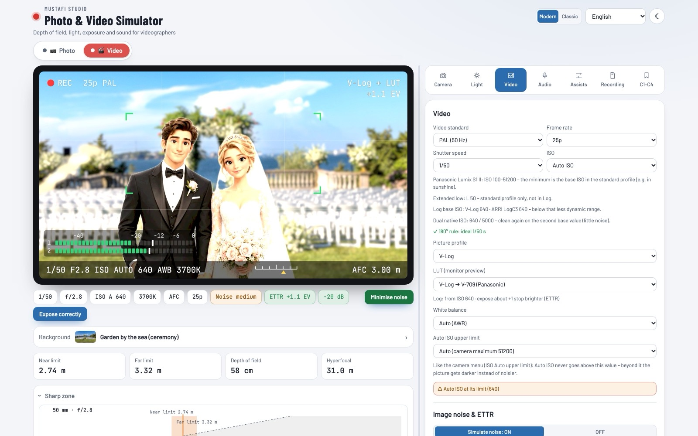
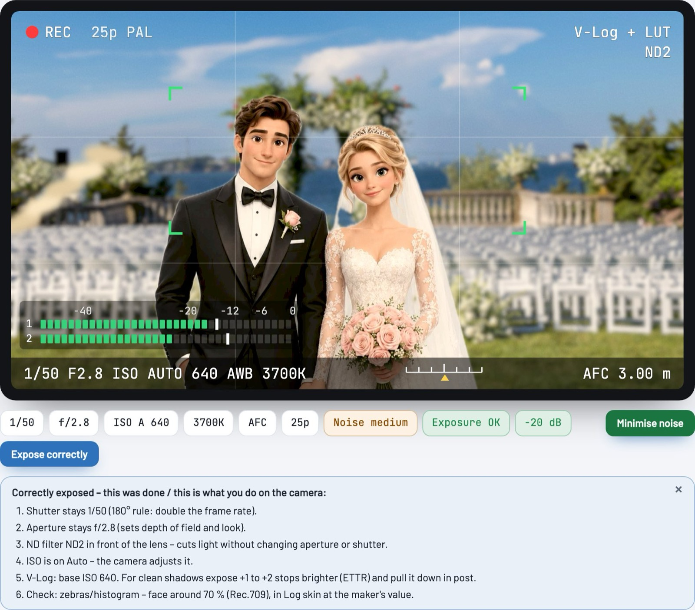
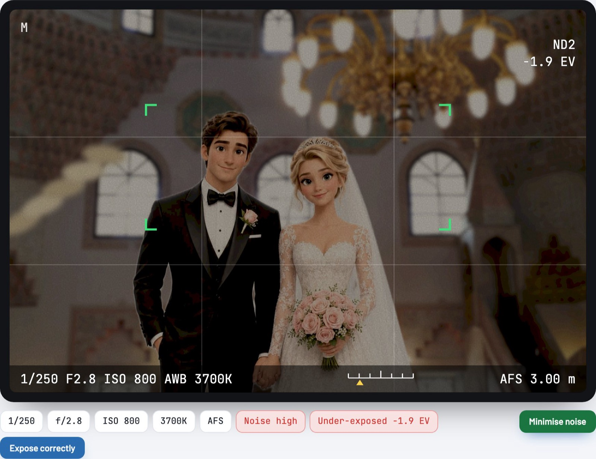
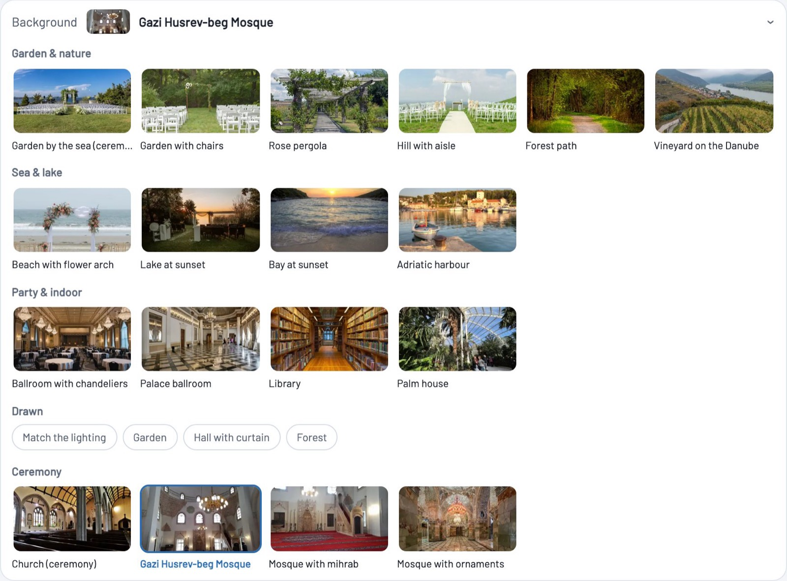
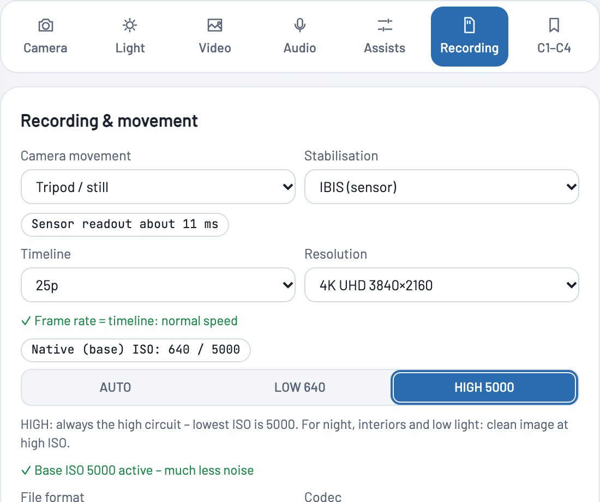
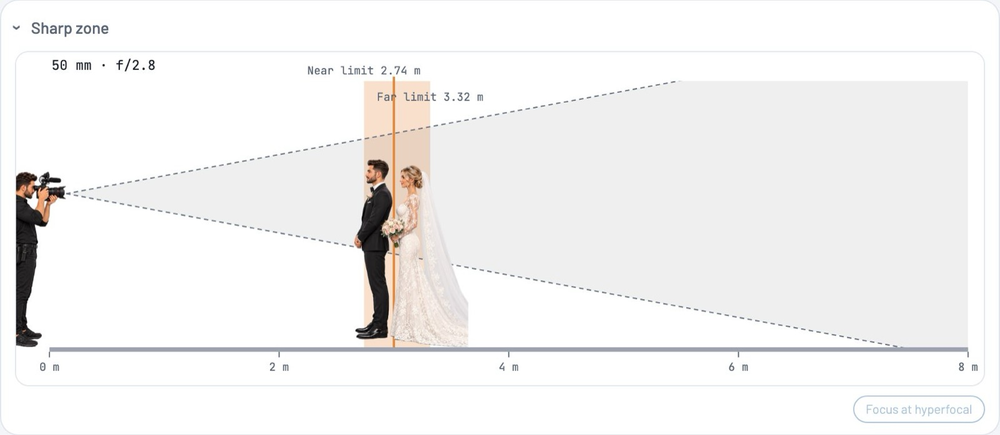

# Photo & Video Simulator · Mustafi Studio

## ▶ [Live demo](https://ado-prog.github.io/video-simulator/)

**[ado-prog.github.io/video-simulator](https://ado-prog.github.io/video-simulator/)** – runs in the browser, free, no sign-up, works on phone and desktop.



| "Expose correctly" tells you what to do on the camera | Noise simulation: under-exposed in a mosque |
|---|---|
|  |  |

| 18 real backgrounds – gardens, sea, halls, church and mosques | Dual native ISO: AUTO / LOW / HIGH |
|---|---|
|  |  |



A depth-of-field, light, exposure and audio simulator for photographers and videographers, made by [Mustafi Studio](https://github.com/Ado-prog) (Switzerland).

See on a simulated camera monitor how focus distance, focal length, aperture, light, shutter, ISO, filters and Log profiles change the picture, before you are on set.

## New

- **Modern design:** big camera monitor, camera status bar and a tabbed panel (Camera, Light, Video, Audio, Assists, Recording, C1–C4); drag the divider to make the monitor or the panel wider. The classic layout is still one click away (Modern | Classic), and you can switch back at any time
- **Image noise & ETTR:** noise grows with ISO, low light and under-exposure, and Log shows it more; turn the simulation on or off, preview "expose to the right" pulled down in post, and see in the status bar when the picture is over- or under-exposed or the highlights clip
- **"Expose correctly" and "Minimise noise":** one click sets shutter, aperture, ND and ISO and lists, step by step, what was done and what you would do on the camera – for every camera, with its own base ISO, Log base ISO and second native ISO
- **Correct ISO per camera:** base ISO in the standard profile (e.g. Lumix S1 II 100, Sony A7S III / FX3 80, Nikon Z8/Z9 64), extended low ISO (L 50) for bright sun, Log base ISO (V-Log 640, S-Log3 800 …)
- **Dual native ISO switch AUTO / LOW / HIGH** on cameras that have it (Lumix S1 II and S1R II and Nikon Z8, Z9, Z6III, Z5II, ZR)
- **18 real 4K backgrounds** with thumbnails: garden by the sea, rose pergola, vineyard on the Danube, Adriatic harbour, ballrooms, library, palm house, a church and three mosques (Gazi Husrev-beg Mosque and others)
- **Real gear photos** for cameras, lenses and microphones, including images supplied by RØDE, and the Nikon ZR

## Features

- **Photo or video:** switch at the top; each mode shows only its own settings (photo: M/A mode, shutter, ISO, camera-shake warning; video: PAL/NTSC, frame rates, Log, audio)
- **Camera monitor preview (16:9)** with background blur and bokeh, REC/HUD, exposure meter and AF frame
- **Sharp zone** from the camera outwards: near and far limit, total depth of field, hyperfocal distance
- **Cameras & lenses:** Panasonic, Sony, Canon, Nikon (plus Sigma and Tamron lenses), DJI (Osmo, action cams, drones) and Insta360
- **Video settings:** PAL/NTSC, frame rates, 180° shutter rule, Auto ISO, white balance, flicker warning under artificial light
- **Log profiles:** V-Log, ARRI LogC3 (Lumix upgrade), S-Log2/3, C-Log2/3, N-Log, D-Log / D-Log M, I-Log, with a choice of monitoring LUT: none (flat Log), the manufacturer's Rec.709 LUTs (e.g. V-709, s709, LC-709, BT.709 Wide DR) or creative looks (warm film, teal & orange, cinema film, black & white)
- **Picture styles (standard / photo):** each camera's own styles, e.g. Lumix Natural, Vivid, Cinelike D2/V2, L.ClassicNeo, Leica Monochrome; Sony Creative Looks and S-Cinetone; Canon Picture Styles; Nikon Picture Controls; DJI Normal/HLG
- **Monitor assists (photo & video):** zebras the way each brand offers them (Lumix Zebra 1/2 at 50–105 %, Sony level or custom range, Canon range ±5 % and overexposure, Nikon 0–255 threshold or mid-tone range), WFM with WAVE or VECTOR, histogram, false color, focus peaking, and frame markers (2.39:1 to 9:16) – up to 3 at once on Lumix S1 II, S1R II, S5 II/IIX, GH7 and G9 II – each with its own aspect and colour, plus a mask
- **Custom modes C1–C4:** save all settings to a mode, rename it and recall it later, like the mode dial on a camera (kept in your browser)
- **Recording & movement (video):** camera movement incl. DJI Ronin gimbals (RS 4 Mini / RS 4 / RS 4 Pro, Lock/PF/PTF/FPV) and stabilisation (IBIS / E-stab crop) with a rolling-shutter warning from each camera's sensor readout time, slow motion up to 200/240p against a 24/25/30p timeline, dual native ISO, resolution (FHD to 8K, Open Gate), the camera's own file formats (Lumix MOV / MP4 / MP4 Lite, Sony XAVC S/HS/S-I, Canon MP4/RAW, Nikon MOV/MP4/N-RAW) and codecs with bitrate, GB per minute and the card you need
- **DMW-DMS1E 4-channel mode:** CH1/CH2 main audio, CH3 omni, CH4 omni −20 dB with their levels
- **Flash & shutter (photo):** TTL and HSS with each camera's sync speed, mechanical / electronic shutter with banding and skew warnings, dynamic range of scene vs. camera, exposure bracketing, 500 and NPF rules for stars, long-exposure and ND time calculator
- **Sun planner:** golden and blue hour, sunrise and sunset for any date in Zürich, Basel, Bern, Sarajevo, Tuzla, Beograd, Wien and more, or your own location
- **Photo backgrounds:** 18 real venues in four groups (garden & nature, sea & lake, party & indoor, ceremony with church and mosques), blurred by the depth of field; the drawn backgrounds stay available
- **Filters:** ND2–ND64000, variable ND, CPL, UV, plus a one-click "expose correctly" that picks the ND you need
- **Lens & mic switches:** lens OIS, AF/MF and focus limiter; on each microphone its own low cut, pad, gain steps, noise cancelling and limiter
- **Audio (video mode):** microphones (RØDE Wireless PRO, Panasonic DMW-DMS1E and DMW-MS2, plus RØDE, DJI, Sennheiser, Deity, Hollyland, Saramonic, Zoom, Tascam, Shure, Comica, Sony, Canon, Nikon and the camera's built-in mic), sound sources, gain, auto level, limiter, low cut, and each mic's own switches – 32-bit float on/off, pickup patterns, wind/noise cancelling, safety track, onboard backup recording – live level meter on the monitor, clipping and noise warnings, speech clarity
- **Group photos in 1, 2 or 3 rows:** each row stands further back, so you can see which rows are still sharp
- **Light scenes:** summer, spring, autumn, winter, overcast, golden hour, blue hour, night, wedding hall, party/disco
- **12 languages:** German, Bosnian, Serbian, Albanian, English, Turkish, Spanish, French, Russian, Japanese, Chinese, Korean

Camera and lens specifications are approximate and meant for planning, not as manufacturer data.

## Run locally

```bash
npm install
npm run dev
```

## License

MIT © 2026 Adis Mustafi (Mustafi Studio)

## Share it

If this helps you on set, a ⭐ on GitHub helps other photographers and videographers find it.

**Keywords:** depth of field calculator, ISO noise simulator, ETTR, dual native ISO, DOF simulator, bokeh preview, exposure simulator, ND filter calculator, 180 degree shutter rule, V-Log, S-Log3, wedding videography, Schärfentiefe-Rechner, Belichtung

## Photo credits

Background and gear photos come from Wikimedia Commons, Pexels and RØDE (supplied by the manufacturer); some Nikon lenses are shown as AI illustrations without logo. Authors and licences: [CREDITS-PHOTOS.md](CREDITS-PHOTOS.md).
