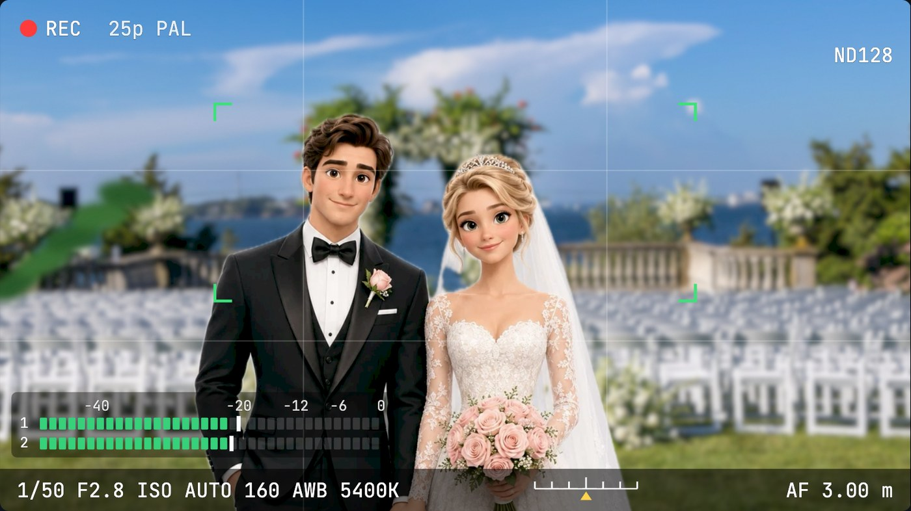
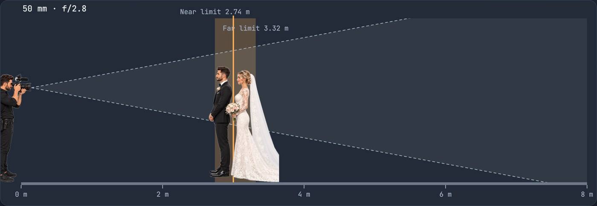
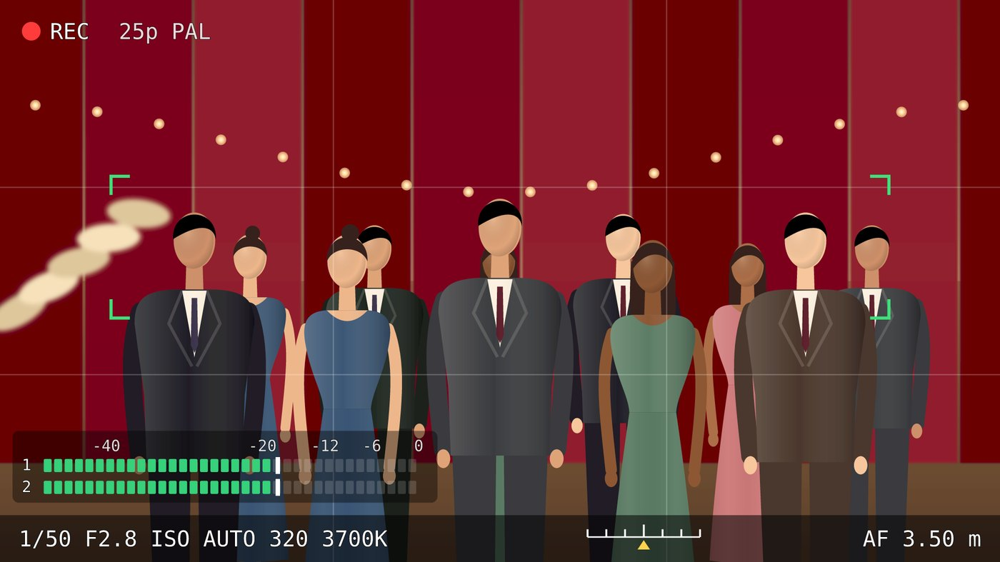

# Photo & Video Simulator · Mustafi Studio

## ▶ [Live demo](https://ado-prog.github.io/video-simulator/)

**[ado-prog.github.io/video-simulator](https://ado-prog.github.io/video-simulator/)** – runs in the browser, free, no sign-up, works on phone and desktop.



| Side view: sharp zone | Group in a wedding hall |
|---|---|
|  |  |

A depth-of-field, light, exposure and audio simulator for photographers and videographers, made by [Mustafi Studio](https://github.com/Ado-prog) (Zürich & Prizren).

See on a simulated camera monitor how focus distance, focal length, aperture, light, shutter, ISO, filters and Log profiles change the picture, before you are on set.

## Features

- **Photo or video:** switch at the top; each mode shows only its own settings (photo: M/A mode, shutter, ISO, camera-shake warning; video: PAL/NTSC, frame rates, Log, audio)
- **Camera monitor preview (16:9)** with background blur and bokeh, REC/HUD, exposure meter and AF frame
- **Sharp zone** from the camera outwards: near and far limit, total depth of field, hyperfocal distance
- **Cameras & lenses:** Panasonic, Sony, Canon, Nikon (plus Sigma and Tamron lenses), DJI (Osmo, action cams, drones) and Insta360
- **Video settings:** PAL/NTSC, frame rates, 180° shutter rule, Auto ISO, white balance, flicker warning under artificial light
- **Log profiles:** V-Log, ARRI LogC3 (Lumix upgrade), S-Log2/3, C-Log2/3, N-Log, D-Log / D-Log M, I-Log, with a choice of monitoring LUT: none (flat Log), the manufacturer's Rec.709 LUTs (e.g. V-709, s709, LC-709, BT.709 Wide DR) or creative looks (warm film, teal & orange, cinema film, black & white)
- **Picture styles (standard / photo):** each camera's own styles, e.g. Lumix Natural, Vivid, Cinelike D2/V2, L.ClassicNeo, Leica Monochrome; Sony Creative Looks and S-Cinetone; Canon Picture Styles; Nikon Picture Controls; DJI Normal/HLG
- **Monitor assists (photo & video):** zebras the way each brand offers them (Lumix Zebra 1/2 at 50–105 %, Sony level or custom range, Canon range ±5 % and overexposure, Nikon 0–255 threshold or mid-tone range), WFM with WAVE or VECTOR, histogram, false color, focus peaking, and frame markers (2.39:1 to 9:16) – up to 3 at once on Lumix S1 II, S1R II, S5 II/IIX, GH7 and G9 II – each with its own aspect and colour, plus a mask
- **Custom modes C1–C4:** save all settings to a mode, rename it and recall it later, like the mode dial on a camera (kept in your browser)
- **Recording & movement (video):** camera movement incl. DJI Ronin gimbals (RS 4 Mini / RS 4 / RS 4 Pro, Lock/PF/PTF/FPV) and stabilisation (IBIS / E-stab crop) with a rolling-shutter warning from each camera's sensor readout time, slow motion up to 200/240p against a 24/25/30p timeline, dual native ISO, resolution (FHD to 8K, Open Gate), the camera's own file formats (Lumix MOV / MP4 / MP4 Lite, Sony XAVC S/HS/S-I, Canon MP4/RAW, Nikon MOV/MP4/N-RAW) and codecs with bitrate, GB per minute and the card you need
- **DMW-DMS1E 4-channel mode:** CH1/CH2 main audio, CH3 omni, CH4 omni −20 dB with their levels
- **Flash & shutter (photo):** TTL and HSS with each camera's sync speed, mechanical / electronic shutter with banding and skew warnings, dynamic range of scene vs. camera, exposure bracketing, 500 and NPF rules for stars, long-exposure and ND time calculator
- **Sun planner:** golden and blue hour, sunrise and sunset for any date in Zürich, Basel, Bern, Sarajevo, Tuzla, Beograd, Wien and more, or your own location
- **Real people (optional):** switch "People" under the monitor from drawn figures to photos – 6 wedding couples, 8 brides, 13 men and 83 women, cut out and placed at their real size and distance, blurred by the depth of field; group photos pick guests automatically
- **Photo backgrounds:** real wedding venues (garden by the sea, garden with chairs, lake at sunset, hill with aisle, beach with flower arch, ballroom), blurred by the depth of field; the drawn backgrounds stay available
- **Filters:** ND2–ND64000, variable ND, CPL, UV, plus a one-click "expose correctly" that picks the ND you need
- **Audio (video mode):** microphones (RØDE Wireless PRO, Panasonic DMW-DMS1E and DMW-MS2, plus RØDE, DJI, Sennheiser, Deity, Hollyland, Saramonic, Zoom, Tascam, Shure, Comica, Sony, Canon, Nikon and the camera's built-in mic), sound sources, gain, auto level, limiter, low cut, and each mic's own switches – 32-bit float on/off, pickup patterns, wind/noise cancelling, safety track, onboard backup recording – live level meter on the monitor, clipping and noise warnings, speech clarity
- **Group photos in 1, 2 or 3 rows:** each row stands further back, so you can see which rows are still sharp
- **Light scenes:** summer, spring, autumn, winter, overcast, golden hour, blue hour, night, wedding hall, party/disco
- **12 languages:** German, Bosnian, Serbian, Albanian, English, Turkish, Spanish, French, Russian, Japanese, Chinese, Korean

Camera and lens specifications are approximate and meant for planning, not as manufacturer data.

## Run locally

```bash
npm install
npm run dev
```

## License

MIT © 2026 Adis Mustafi (Mustafi Studio)

## Share it

If this helps you on set, a ⭐ on GitHub helps other photographers and videographers find it.

**Keywords:** depth of field calculator, DOF simulator, bokeh preview, exposure simulator, ND filter calculator, 180 degree shutter rule, V-Log, S-Log3, wedding videography, Schärfentiefe-Rechner, Belichtung

## Photo credits

Background photos from [Pexels](https://www.pexels.com/license/) (free to use), cropped and resized:
[Mohan Nannapaneni](https://www.pexels.com/photo/wedding-decoration-in-a-garden-13931905/) (garden by the sea),
[Alina T](https://www.pexels.com/photo/chairs-and-arch-outdoors-for-wedding-ceremony-11433914/) (garden with chairs),
[Paul Lichtblau](https://www.pexels.com/photo/sunset-lakeside-wedding-setup-in-brandenburg-40248731/) (lake at sunset),
[Lukas Blazek](https://www.pexels.com/photo/wedding-reception-574011/) (hill with aisle),
[Soly Moses](https://www.pexels.com/photo/arch-decorated-with-white-cloth-and-flowers-10962460/) (beach with flower arch),
[Clément Proust](https://www.pexels.com/photo/luxury-restaurant-hall-19569865/) (ballroom).

People photos: 95 from [Pexels](https://www.pexels.com/license/) and 15 from [Unsplash](https://unsplash.com/license) (free to use), cut out and resized. The original photo page of every person is listed in [`src/people.json`](src/people.json) (`src`).
